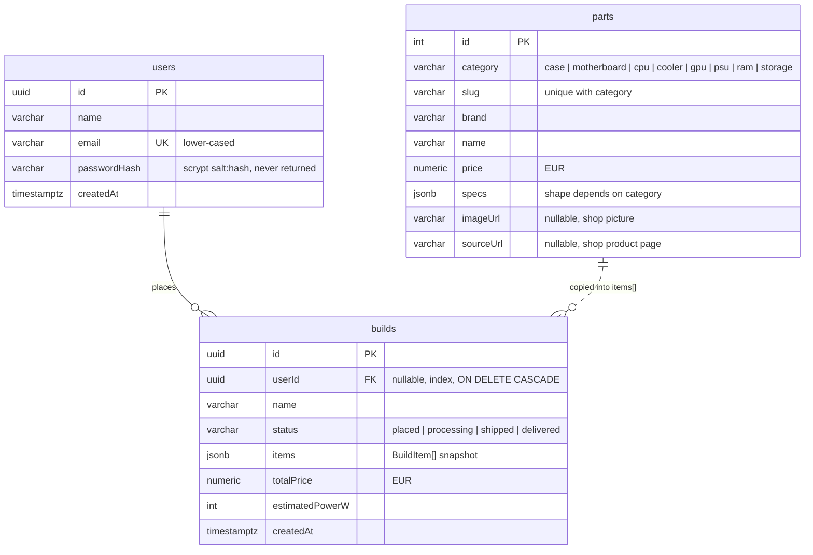

# BYPC database

PostgreSQL (hosted on **Neon**, resource `buypc-db`, connected to the `buypc-api` Vercel project through
`DATABASE_URL` / `POSTGRES_URL`). Tables are created and updated from the TypeORM entities
(`synchronize: true` in `src/app.module.ts`), so the entity files are the source of truth:

| Table    | Entity file                     |
| -------- | ------------------------------- |
| `users`  | `src/users/user.entity.ts`      |
| `parts`  | `src/parts/part.entity.ts`      |
| `builds` | `src/builds/build.entity.ts`    |



## `users`

| Column         | Type           | Notes                                                    |
| -------------- | -------------- | -------------------------------------------------------- |
| `id`           | `uuid` PK      | generated                                                |
| `name`         | `varchar(120)` |                                                          |
| `email`        | `varchar(254)` | **unique**, stored lower-case so login ignores case      |
| `passwordHash` | `varchar(200)` | scrypt, `salt:hash` in hex. Excluded from normal selects |
| `createdAt`    | `timestamptz`  | set on insert                                            |

Login returns a JWT (`JWT_SECRET`, valid 7 days) that the website sends as `Authorization: Bearer …`.

## `parts`

The catalog. Unique index on **(`category`, `slug`)** so re-seeding updates rows instead of duplicating them.

| Column      | Type            | Notes                                            |
| ----------- | --------------- | ------------------------------------------------ |
| `id`        | `serial` PK     |                                                  |
| `category`  | `varchar(20)`   | one of the 8 build steps                         |
| `slug`      | `varchar(120)`  | stable key, e.g. `amd-ryzen-7-7800x3d`           |
| `brand`     | `varchar(60)`   |                                                  |
| `name`      | `varchar(160)`  |                                                  |
| `price`     | `numeric(10,2)` | euros                                            |
| `specs`     | `jsonb`         | see below                                        |
| `imageUrl`  | `varchar(500)`  | product picture (hosted by the shop), may be null |
| `sourceUrl` | `varchar(500)`  | shop page the price/picture came from            |

`specs` per category (types in `src/parts/part.types.ts`), only the fields the compatibility checker
and recommender use:

| Category      | `specs` fields                                                                                           |
| ------------- | -------------------------------------------------------------------------------------------------------- |
| `case`        | `size`, `supportedMotherboards[]`, `maxGpuLengthMm`, `maxCoolerHeightMm`, `maxRadiatorMm`, `psuFormFactors[]` |
| `motherboard` | `socket`, `chipset`, `formFactor`, `memoryType`, `memorySlots`, `maxMemoryGb`, `m2Slots`, `sataPorts`     |
| `cpu`         | `socket`, `cores`, `threads`, `boostGhz`, `tdpW`, `maxPowerW`, `integratedGraphics`, `gamingTier`, `workTier` |
| `cooler`      | `type` (Air/Liquid), `sockets[]`, `heightMm` (air), `radiatorMm` (liquid), `tdpRatingW`                   |
| `gpu`         | `chip`, `vramGb`, `lengthMm`, `powerW`, `recommendedPsuW`, `tier`                                        |
| `psu`         | `wattage`, `formFactor` (ATX/SFX), `efficiency`, `modular`                                               |
| `ram`         | `memoryType`, `capacityGb`, `modules`, `speedMts`                                                        |
| `storage`     | `interface` (NVMe/SATA), `formFactor` (M.2 / 2.5" / 3.5"), `capacityGb`                                   |

### Where the rows come from

Seeded on every API start by `src/seed/parts.seeder.ts`:

1. **`src/seed/parts.data.ts`** – hand-checked parts with manufacturer specs.
2. **`src/seed/scraped.data.ts`** – generated by the scraper (below). Holds parts from gjirafa50.com
   whose specs could be worked out reliably, plus the shop's € price and picture for the hand-checked
   parts it matched (`CURATED_FROM_SHOP`).

Refreshing the catalog:

```bash
node scripts/scrape/fetch.mjs        # crawl the shop, cache raw pages (scripts/scrape/.cache, not committed)
node scripts/scrape/normalize.mjs    # turn the cache into src/seed/scraped.data.ts
```

## `builds` (orders)

| Column            | Type            | Notes                                                       |
| ----------------- | --------------- | ----------------------------------------------------------- |
| `id`              | `uuid` PK       |                                                             |
| `userId`          | `uuid` FK → `users.id` | indexed; null only for orders placed before accounts |
| `name`            | `varchar(120)`  |                                                             |
| `status`          | `varchar(20)`   | `placed` (default), `processing`, `shipped`, `delivered`    |
| `items`           | `jsonb`         | `[{ category, partId, brand, name, price }]`                |
| `totalPrice`      | `numeric(10,2)` | euros                                                       |
| `estimatedPowerW` | `int`           |                                                             |
| `createdAt`       | `timestamptz`   |                                                             |

`items` is a **snapshot** of each part at order time, so later price or catalog changes never rewrite an
order. `partId` still points at `parts.id` for reference, but there's no foreign key on it.

## API endpoints that touch the database

| Method & path               | Auth | What it does                                  |
| --------------------------- | ---- | --------------------------------------------- |
| `POST /api/auth/register`   | –    | create user, returns `{ token, user }`        |
| `POST /api/auth/login`      | –    | returns `{ token, user }`                     |
| `GET /api/auth/me`          | ✔    | current user                                  |
| `GET /api/parts?category=…` | –    | all parts in a category                       |
| `POST /api/parts/options`   | –    | parts with compatibility + recommendation     |
| `POST /api/builds/check`    | –    | validate a (partial) build                    |
| `POST /api/builds`          | ✔    | place an order for the logged-in user         |
| `GET /api/builds`           | ✔    | the logged-in user's orders                   |
| `GET /api/builds/:id`       | ✔    | one of the logged-in user's orders            |
